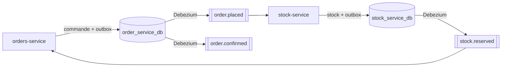

# 📤 Transactional Outbox + Debezium CDC

`orders-service` et `stock-service` ne publient jamais directement sur Kafka : chaque événement
est écrit dans une table `outbox_event`, dans la même transaction que la modification métier,
puis **Debezium** le publie sur Kafka.

---

## Parcours complet

1. `POST /orders` écrit la commande et `order.placed` dans l'outbox d'`orders`, et Debezium publie le message.
2. `stock-service` réserve le stock et écrit `stock.reserved` dans son outbox, que Debezium publie.
3. `orders-service` confirme la commande et écrit `order.confirmed` dans son outbox, que Debezium publie.

---

## Schéma de communication

