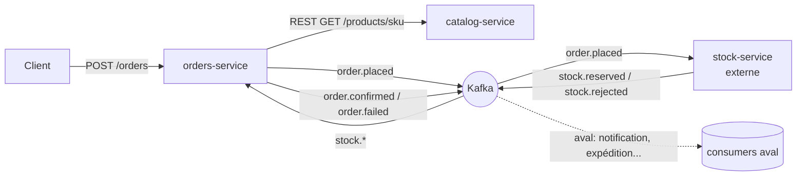
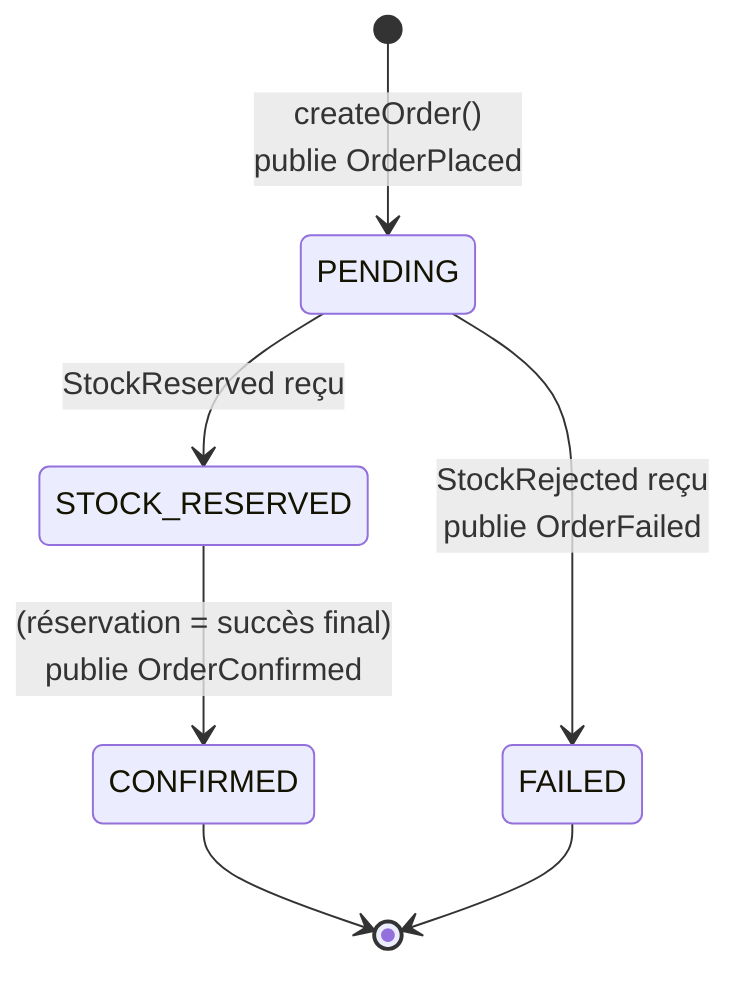
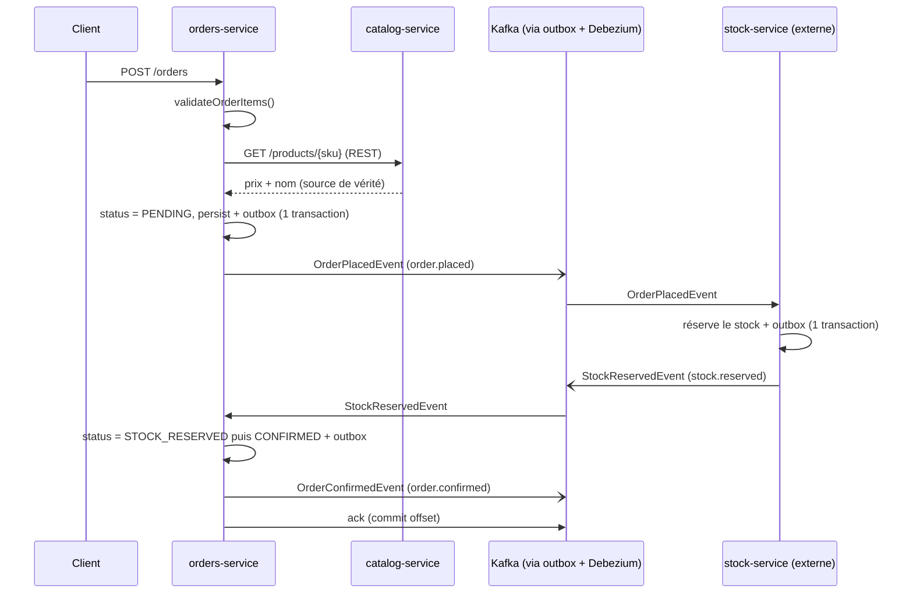

# 🔄 Saga — Flux, événements et transitions d'état

Documentation du Saga *chorégraphié* (event-driven, sans orchestrateur central) de la
plateforme retail. Cette page décrit le parcours d'une commande, les événements Avro
échangés via Kafka, et la machine à états de `OrderEntity`.

> Périmètre : `orders-service` (ce repo) ↔ `stock-service` (**micro-service externe**).
> `catalog-service` n'est **pas** dans le Saga : il est interrogé en **REST synchrone**
> pour enrichir la commande (source de vérité prix/nom). Voir [Pourquoi REST](#pourquoi-catalog-service-reste-en-rest).

---

## 1. Vue d'ensemble

| Service | Rôle | Transport |
| --- | --- | --- |
| **orders-service** | Création de commande + réactions Saga | Produit/consomme Kafka, appelle catalog en REST |
| **catalog-service** | Source de vérité produits (SKU, prix, nom) | **REST** uniquement |
| **stock-service** *(externe)* | Réservation / rejet de stock | Produit/consomme Kafka |

> 📤 Les services ne **produisent** jamais directement sur Kafka : leurs événements passent par
> une table `outbox_event` publiée par Debezium (CDC). Les flèches « service → Kafka » de cette
> page sont donc logiques. Parcours et schéma : [`outbox-cdc.md`](outbox-cdc.md).

---

## 2. Catalogue des événements (contrats Avro)

Tous les schémas vivent dans le module **`retail-event-schema`** (`src/main/avro/`) et sont
générés en classes Java `SpecificRecord` (`enableDecimalLogicalType=true`, `stringType=String`).

| Événement | Topic | Producteur | Consommateur | Schéma |
| --- | --- | --- | --- | --- |
| `OrderPlacedEvent` | `order.placed` | orders-service | stock-service | `avro/order/OrderPlacedEvent.avsc` |
| `StockReservedEvent` | `stock.reserved` | stock-service | orders-service | `avro/stock/StockReservedEvent.avsc` |
| `StockRejectedEvent` | `stock.rejected` | stock-service | orders-service | `avro/stock/StockRejectedEvent.avsc` |
| `OrderConfirmedEvent` | `order.confirmed` | orders-service | aval (notif, expédition…) | `avro/order/OrderConfirmedEvent.avsc` |
| `OrderFailedEvent` | `order.failed` | orders-service | aval (notif, compensation…) | `avro/order/OrderFailedEvent.avsc` |

**Clé Kafka = `orderId`** pour tous les événements → tous les messages d'une même commande
tombent dans la **même partition**, garantissant l'ordre de traitement (condition essentielle au Saga).

### Conventions Schema Registry

- **Subject naming** : `TopicNameStrategy` (défaut) → subject = `<topic>-value`.
- **Compatibilité** : mode `BACKWARD` (défaut). Tout nouveau champ doit avoir un `default`
  (cf. `version` qui vaut `"v1"`).
- **Montants** : `decimal(precision=19, scale=2)` → `java.math.BigDecimal`, normalisé en `scale=2`
  avant sérialisation (`setScale(2, HALF_UP)`).
- **Dates** : `timestamp-millis` → `java.time.Instant`.

---

## 3. Machine à états de la commande

### Diagramme

### Tableau des transitions

| État départ | Déclencheur | État arrivée | Effet de bord | Where |
| --- | --- | --- | --- | --- |
| — | `POST /orders` validée + persistée | **PENDING** | `OrderPlacedEvent` → outbox → `order.placed` | `OrderServiceImpl.createOrder` |
| PENDING | reçoit `StockReservedEvent` | **STOCK_RESERVED** | save (réservation actée) | `StockEventListener.onStockReserved` |
| STOCK_RESERVED | (immédiat, pas d'étape paiement) | **CONFIRMED** | `OrderConfirmedEvent` → outbox → `order.confirmed` | `StockEventListener.onStockReserved` |
| PENDING | reçoit `StockRejectedEvent` | **FAILED** | `OrderFailedEvent` → outbox → `order.failed` | `StockEventListener.onStockRejected` |

> ℹ️ `onStockReserved` enchaîne **deux** transitions dans la même transaction :
> `STOCK_RESERVED` puis `CONFIRMED`. La réservation est **actée avant** la confirmation
> (deux `save` successifs) — on ne saute jamais directement à `CONFIRMED`.

### États déclarés mais non encore utilisés

L'enum `OrderStatus` prévoit des états pour une évolution future, **non câblés** aujourd'hui :

| État | Usage prévu |
| --- | --- |
| `STOCK_CHECKING` | Attente active de la réponse stock |
| `PAYMENT_PROCESSING` | Étape paiement (quand un `payment-service` existera) |
| `CANCELLED` | Annulation client |
| `REJECTED` | Rejet métier distinct de `FAILED` |

> Quand un `payment-service` sera ajouté, la confirmation devra migrer **après**
> `PAYMENT_PROCESSING` : le bloc « réservation → confirmation » de `onStockReserved`
> sera alors à scinder (`STOCK_RESERVED` ici, `CONFIRMED` déclenché par l'événement paiement).

---

## 4. Séquence nominale (succès)

Les flèches `-)` vers Kafka sont asynchrones : l'événement est écrit dans `outbox_event` et publié
par Debezium après le commit. Parcours et schéma de communication : [`outbox-cdc.md`](outbox-cdc.md#parcours-complet).

Chemin d'échec : `stock-service` publie `StockRejectedEvent` → `orders-service` passe la
commande en `FAILED` et publie `OrderFailedEvent`.

---

## 5. Garanties & invariants

- **Idempotence à la création** : `OrderEntity.idempotencyKey`. Si une clé fournie par le
  client existe déjà, la commande est renvoyée sans nouvelle création
  (`OrderServiceImpl` — `findByIdempotencyKey`). Une clé absente est générée aléatoirement
  (donc *pas* d'idempotence pour ces requêtes — comportement assumé).
- **Ordre par commande** : clé Kafka = `orderId` → 1 partition par commande.
- **Ack manuel** : consumers en `AckMode.MANUAL`. L'offset n'est commité qu'après traitement.
  Si la commande est introuvable, on `ack` quand même (rejouer n'aiderait pas → évite le *poison pill*).
- **Dead Letter Topic** : un message en échec est rejoué 3 fois (backoff 1s → 2s → 4s) puis
  publié sur `<topic>.dlt` et son offset est commité — la partition n'est jamais bloquée.
  Messages illisibles (désérialisation) et `IllegalArgumentException` partent en DLT sans rejeu.
  Détails : [§ 6 bis](#6-bis-dead-letter-topics-dlt).
- **Validation avant enrichissement** : `validateOrderItems()` s'exécute **avant** l'appel
  REST catalog → évite un `NullPointerException` sur `items == null` et des appels inutiles.

---

## 6. Provisioning des topics

`orders-service` crée explicitement (beans `NewTopic` dans `KafkaTopicsConfig`) **uniquement
les topics qu'il possède** (domaine `order`) : `order.placed`, `order.confirmed`, `order.failed`
— 3 partitions, réplication 1 (broker unique en local).

Les topics `stock.reserved` / `stock.rejected` sont la responsabilité du **stock-service**
(leur producteur). orders-service ne fait que les consommer.

Le broker tourne avec `auto.create.topics.enable=false` : si orders-service démarre avant
stock-service, il attend la création des topics `stock.*` au lieu de les faire créer
implicitement avec 1 partition.

---

## 6 bis. Dead Letter Topics (DLT)

Chaque service crée et alimente les DLT **des topics qu'il consomme** (c'est le consommateur
qui y écrit) :

| Service | Topic consommé | DLT |
| --- | --- | --- |
| orders-service | `stock.reserved` | `stock.reserved.dlt` |
| orders-service | `stock.rejected` | `stock.rejected.dlt` |
| stock-service | `order.placed` | `order.placed.dlt` |

Configuration : `KafkaDeadLetterConfig` (`DefaultErrorHandler` + `DeadLetterPublishingRecoverer`).

| Cas | Rejeux | Contenu publié en DLT |
| --- | --- | --- |
| Exception métier/technique (ex. base indisponible) | 3 (1s, 2s, 4s) | l'événement Avro d'origine |
| `IllegalArgumentException` (ex. `orderId` non UUID) | 0 | l'événement Avro d'origine |
| Message illisible / *poison pill* (`DeserializationException`) | 0 | les octets bruts d'origine |

- Même **clé** (`orderId`) que le message source. Les DLT ont **1 partition** et aucune
  partition n'est imposée à l'envoi : volume faible, lecture manuelle, messages dans leur ordre
  d'arrivée, et augmenter les partitions d'un topic source ne casse pas la DLT. La partition
  d'origine reste dans le header `kafka_dlt-original-partition`.
- Headers ajoutés par Spring pour le diagnostic et le rejeu : `kafka_dlt-original-topic`,
  `kafka_dlt-original-partition`, `kafka_dlt-original-offset`, `kafka_dlt-exception-fqcn`,
  `kafka_dlt-exception-message`, `kafka_dlt-exception-stacktrace`… On y ajoute
  `dlt-delivery-attempts` : le nombre de tentatives avant l'envoi en DLT (`1` ou `4`), en texte
  pour être lisible dans Conduktor.
- La DLT est publiée **directement** sur Kafka (pas via l'outbox) : c'est un mécanisme
  d'infrastructure, sans état métier à garder cohérent avec la base.
- Les consumers restent en `AckMode.MANUAL` : l'offset du message envoyé en DLT est commité
  après coup par le container (`ackAfterHandle`). `MANUAL_IMMEDIATE` est évité car il
  commiterait l'offset **avant** le commit de la transaction JPA du listener.
- Pas de rejeu automatique depuis la DLT : on corrige la cause, puis on republie le message
  sur le topic d'origine (ex. via Conduktor).

---

## 7. Pourquoi catalog-service reste en REST

catalog-service est un **fournisseur de données de référence** interrogé en **requête/réponse
synchrone** (récupération prix/nom au moment de créer la commande). C'est le cas d'usage de REST,
pas de Kafka :

| Critère | catalog lookup | événement Saga |
| --- | --- | --- |
| Interaction | question/réponse immédiate | asynchrone, fire-and-forget |
| Couplage temporel | acceptable | à éviter |
| Bon transport | **REST / RestClient** | **Kafka + Avro** |

`ProductEntity` ne porte d'ailleurs **aucune notion de stock** — la réservation est un bounded
context distinct (le `stock-service`). Mettre un lookup produit sur Kafka serait une erreur d'architecture.

---

## 8. Limites connues / durcissements à venir

- ~~**Transactional outbox**~~ : ✅ en place (orders-service et stock-service) — voir
  [`outbox-cdc.md`](outbox-cdc.md). Reste à rendre orders-service idempotent face aux
  redélivrances (at-least-once) et à purger `outbox_event`.
- ~~**Dead Letter Topic**~~ : ✅ en place — voir [§ 6 bis](#6-bis-dead-letter-topics-dlt).
  Reste à outiller le rejeu depuis la DLT et à alerter sur son volume.
- **Partage du contrat Avro inter-repos** : `retail-event-schema` n'est pas publié
  (install local). Pour éviter le *drift* de schéma avec le stock-service externe, publier le
  module dans un repo Maven partagé **ou** traiter le Schema Registry comme source de vérité.
- **Compensation** : pas de rollback de stock si une étape ultérieure échoue (pertinent quand
  un `payment-service` existera).